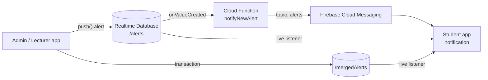

# Real-Time Emergency Alert System


An Android app for broadcasting campus emergency alerts in real time. Admins and lecturers send alerts (fire, chemical exposure, medical emergency, or a custom message) for a specific area. Students get them instantly as a live feed and as a push notification, even when the app is closed.

Originally built as a university project at Universiti Utara Malaysia (UUM).

## Features

- **Role-based access**: admin, lecturer, and student accounts using Firebase Authentication, with each role stored in the database
- **Real-time alert feed**: new alerts appear on every device straight away through Firebase Realtime Database listeners
- **Push notifications**: a Cloud Function sends every new alert to students through Firebase Cloud Messaging (FCM)
- **Duplicate alert merging**: repeated alerts for the same message and area within 5 seconds are merged into one card with a counter (`High (×3)`), using a database transaction so concurrent senders can't lose updates
- **Acknowledge queue**: students acknowledge alerts one by one; acknowledged alerts don't come back
- **Server-side security rules**: only signed-in users can read alerts, only admins and lecturers can create them, and users can only read their own role

## Tech stack

| Layer | Technology |
|---|---|
| App | Java, Android SDK 35, Material Components, RecyclerView |
| Auth | Firebase Authentication (email/password) |
| Data | Firebase Realtime Database + security rules |
| Push | Firebase Cloud Messaging, Cloud Functions for Firebase (Node.js 20) |
| CI | GitHub Actions (build + unit tests, uploads the debug APK) |

## How it works



### Concurrency

- Alerts are sent on a fixed thread pool, so the UI thread never blocks on network work.
- Merging uses a **fair `ReentrantLock` with `tryLock` timeout** on the device, plus a **Realtime Database transaction** on the server, so two admins sending the same alert at the same time increment the counter correctly.
- The student screen processes the alert queue on a **single-thread executor** and guards the shared queue with `synchronized`, so acknowledgements and incoming alerts can't race.

## Project structure

```
app/src/main/java/com/fyp/alertsystem/
├── MainActivity.java               # Login (Firebase Auth) + role routing
├── AdminActivity.java              # Create alerts, merge logic, alert history
├── StudentActivity.java            # Live alert card, acknowledge queue, history
├── AlertHistoryAdapter.java        # RecyclerView adapter for alert history
├── MyFirebaseMessagingService.java # Shows push notifications
├── Alert.java                      # Alert model
└── AppConfig.java                  # Shared constants and helpers
functions/index.js                  # Cloud Function: new alert -> FCM push
database.rules.json                 # Realtime Database security rules
```

## Getting started

### 1. Create a Firebase project

1. Create a project in the [Firebase console](https://console.firebase.google.com/).
2. Add an Android app with package name `com.fyp.alertsystem`.
3. Download `google-services.json` into `app/`. It is git-ignored; see `app/google-services.json.example` for the format.
4. Turn on **Authentication → Email/Password**.
5. Create a **Realtime Database**. If its URL is not in your `google-services.json` (databases outside `us-central1`), add it to `local.properties`:
   ```properties
   firebase.databaseUrl=https://<your-project>-default-rtdb.<region>.firebasedatabase.app
   ```

### 2. Create users and roles

1. In **Authentication → Users**, add accounts (for example `admin@example.com`, `student@example.com`).
2. In the Realtime Database, add each user's role under their UID:
   ```json
   {
     "users": {
       "<admin-uid>":   { "role": "admin" },
       "<student-uid>": { "role": "student" }
     }
   }
   ```
   Valid roles: `admin`, `lecturer`, `student`.

### 3. Deploy the rules and Cloud Function

Requires the [Firebase CLI](https://firebase.google.com/docs/cli). Cloud Functions need the Blaze (pay-as-you-go) plan; this app stays well within the free tier.

```bash
firebase use --add                 # pick your project
cd functions && npm install && cd ..
firebase deploy --only database,functions
```

If your database isn't in `asia-southeast1`, change `DATABASE_REGION` in `functions/index.js` first.

### 4. Run the app

Open the project in Android Studio and run it, or build from the command line:

```bash
./gradlew assembleDebug testDebugUnitTest
```

## License

This project is for educational and portfolio purposes.
